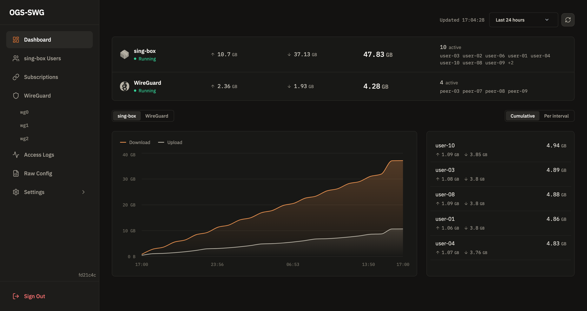

# OGS-SWG

Web panel for managing **Sing-box** and **WireGuard** servers. Go backend, React frontend, SQLite storage, shipped as a single binary.



[Live demo](https://swg-demo.ogstra.com/) (no login required)

## Requirements

*   Linux host running Sing-box and/or WireGuard (`wg-quick`) under systemd.
*   Sing-box built with the tags listed [below](#sing-box-build-tags). The official binaries include them.
*   Go 1.26 and Node.js to build from source, or Docker.

## Features

|             | Reality | TLS | None | TCP | WebSocket | HTTP | gRPC | HTTP Upgrade | UDP |
|-------------|:-------:|:---:|:----:|:---:|:---------:|:----:|:----:|:------------:|:---:|
| VLESS       | ✓ | ✓ | ✓ | ✓ | ✓ | ✓ | ✓ | ✓ | — |
| VMess       | — | ✓ | ✓ | ✓ | ✓ | ✓ | ✓ | ✓ | — |
| Trojan      | — | ✓ | ✓ | ✓ | ✓ | ✓ | ✓ | ✓ | — |
| Hysteria2   | — | ✓ | — | — | — | — | — | — | ✓ |
| Shadowsocks | — | — | ✓ | ✓ | — | — | — | — | ✓ |
| AnyTLS      | — | ✓ | — | ✓ | — | — | — | — | — |
| Naive       | — | ✓ | — | ✓ | — | — | — | — | ✓ |
| WireGuard   | — | — | — | — | — | — | — | — | ✓ |

*   **Inbounds and users**: create and edit Sing-box inbounds and their users, with traffic limits and expiry dates.
*   **WireGuard**: manage interfaces and peers, or edit the raw `.conf`.
*   **Traffic**: per-user stats for Sing-box, per-peer stats for WireGuard.
*   **Subscriptions**: one link per user bundle for clients such as Happ and Shadowrocket, with per-member aliases, quotas, refresh headers, request history, QR codes and protection rules (token/IP block, allowlist, rate limit, browser filtering). Each device is tracked by its HWID and can be moved to another subscription.
*   **Services**: restart or reload Sing-box and WireGuard, tail logs, edit whitelisted sysctl values and the raw Sing-box config.
*   **Notifications**: [ntfy](https://ntfy.sh) alerts for service down, high traffic, config apply failures and new or moved devices.

## Install

The panel runs either directly on the host (`local`, the default) or in a container on the same host (`docker_local`).

**Local.** Build, then run:

```bash
git clone https://github.com/Ogstra/ogs-swg && cd ogs-swg
cp config.json.example config.json
./scripts/build_all.sh
./ogs-swg -config config.json
```

**Docker.** The panel container runs commands on the host through `systemd-run`, so the compose file mounts the host's systemd, dbus and journal sockets, plus `/etc/sing-box` and `/etc/wireguard`:

```bash
cd docker/docker-local
OGS_API_KEY=<your-key> docker compose up -d
```

See [`docker/docker-local/docker-compose.yml`](docker/docker-local/docker-compose.yml) for the mounts. Two things worth knowing:

*   If Sing-box logs somewhere else, set `OGS_ACCESS_LOG_HOST_DIR` to that directory and point `OGS_ACCESS_LOG_PATH` at the file under `/app/access-logs`.
*   For External Profiles with dynamic IP files, set `OGS_EXTERNAL_PROFILE_IP_HOST_DIR` to the host directory and use the container path in the UI, e.g. `/app/external-profile-ip/sing-box` for a file named `sing-box`.

For blue/green slots use host networking and a per-slot port:

```yaml
network_mode: host
environment:
  - OGS_DOCKER_LOCAL_HOST_NETWORK=true
  - OGS_LISTEN_ADDR=:18080   # blue; green uses :18081
```

### First admin

If no admin exists on first start, set `OGS_ADMIN_USER` and `OGS_ADMIN_PASSWORD`. Use your own values and remove them afterwards.

## Configuration

Settings come from `config.json`, `.env` and environment variables. The common ones:

```json
{
  "listen_addr": ":8080",
  "api_key": "",
  "jwt_secret": "",
  "database_path": "./data/stats.db",
  "singbox_config_path": "/etc/sing-box/config.json",
  "wireguard_config_path": "/etc/wireguard/wg0.conf",
  "managed_inbounds": ["in-reality"],
  "stats_inbounds": ["in-reality"]
}
```

Add tags to `managed_inbounds` and `stats_inbounds` to manage several inbounds. Everything else, and the `OGS_*` variable names, is in [`internal/core/config.go`](internal/core/config.go).

## Sing-box build tags

| Tag | Purpose |
|-----|---------|
| `with_clash_api` | Clash API for hot config reload (zero-downtime restarts) |
| `with_v2ray_api` | V2Ray StatsService for per-user traffic stats |
| `with_gvisor` | Network stack for tun mode |
| `with_quic` | QUIC transport (required for Hysteria2) |
| `with_utls` | uTLS fingerprinting for Reality |
| `badlinkname` | Required for Go 1.24+ compatibility |

To build Sing-box yourself:

```bash
go build -v -tags "with_clash_api,with_v2ray_api,with_gvisor,with_quic,with_utls,badlinkname" \
    ./cmd/sing-box
```

### Clash API

Add a `clash_api` block under `experimental` in the Sing-box config:

```json
"experimental": {
  "clash_api": {
    "external_controller": "127.0.0.1:9090"
  }
}
```

With `external_controller` set, the panel reloads config through `PUT /configs` instead of restarting the service. If `secret` is set, the panel sends it as a Bearer token.

> **Docker:** inside the panel container `127.0.0.1` is the container itself. Bind `external_controller` to the Docker bridge IP (usually `172.17.0.1:9090`) or `0.0.0.0:9090`.

## Deploy

Blue/green deployment through GitHub Actions, with a watchdog, health checks and automatic rollback. See [DEPLOY_GITHUB_ACTIONS.md](DEPLOY_GITHUB_ACTIONS.md). The public demo deploys separately via `deploy-demo.yml`.

## Development

```bash
go test ./...
cd frontend && npm run build
```

Both must pass before committing.

## License

MIT
